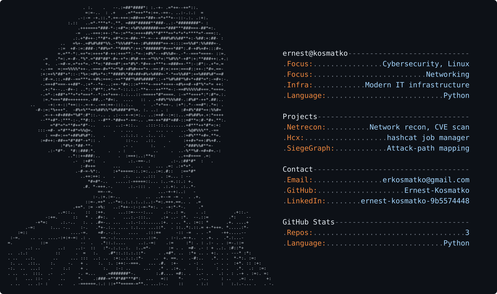

## About

I do penetration testing of web applications, APIs and infrastructure, sometimes cloud configuration, for e-commerce, manufacturing and finance companies. Most of the work is freelance and under NDA.

I am most interested in the bugs scanners miss: business logic and permission flaws, the things that only show up when someone really tries to get around the system. I write reports so a developer can understand the problem and fix it without follow-up questions.

I am looking for new engagements and contacts in the industry. If you want your application tested, or just want to talk security, get in touch.

## Personal projects

| Project | Description |
|---|---|
| [NetRecon](https://github.com/Ernest-Kosmatko/NetRecon) | Network reconnaissance and vulnerability scanner with CVE signatures and HTML, JSON and CSV reports |
| [Hcx](https://github.com/Ernest-Kosmatko/Hcx) | hashcat wrapper with job management, reporting, attack planning and tuning |
| [SiegeGraph](https://github.com/Ernest-Kosmatko/SiegeGraph) | Attack-path mapping and evidence management for authorized penetration tests |
| [authmatrix](https://github.com/Ernest-Kosmatko/authmatrix) | Authorization tester for REST APIs: replays requests across identities and finds BOLA, BFLA, mass assignment and business logic flaws |
| [ShopAPI-Lab](https://github.com/Ernest-Kosmatko/ShopAPI-Lab) | Deliberately vulnerable shop API (IDOR, mass assignment, business logic) with write-ups and fixes |
| [Portscan](https://github.com/Ernest-Kosmatko/Portscan) | Multithreaded TCP port scanner with banner grabbing |
| [Webhygiene](https://github.com/Ernest-Kosmatko/Webhygiene) | HTTP security header, cookie and TLS checker |
| [Dirbrute](https://github.com/Ernest-Kosmatko/Dirbrute) | Web content discovery with soft-404 detection |
| [Pentest-report-template](https://github.com/Ernest-Kosmatko/Pentest-report-template) | Penetration test report template with an example finding |
